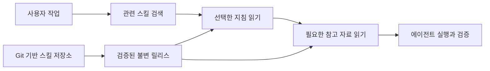

<p align="center"><a href="README.md">English</a> · <a href="README.ko.md">한국어</a></p>

<p align="center">
  
</p>

<h1 align="center">gisul · 기술</h1>
<p align="center"><strong>Stop selling magic. Give your agent a procedure.</strong><br>암묵지를 업로드했다고? 그럴듯한 소리 그만.</p>
<p align="center">
  <a href="#시작하기">시작하기</a> ·
  <a href="https://github.com/changeroa/gisul-skills/blob/main/README.ko.md">스킬 둘러보기</a> ·
  <a href="docs/technical-reference.md">기술 문서</a> ·
  <a href="https://github.com/changeroa/gisul/issues">문제 제보</a>
</p>
<p align="center">
  <a href="LICENSE"></a>
  
  
</p>

---

## AI한테 노하우를 넣었다고?

**프롬프트 몇 줄 적었다고 숙련까지 복제되는 건 아니다.**

“전문가처럼 생각해.” “꼼꼼하게 검토해.” “알아서 잘해.”<br>
말은 쉽다. 그래서 뭘 읽고, 뭘 확인하고, 무슨 근거로 끝낼 건데?

gisul은 그 질문에 쓸 **작업 지침을 찾아 전달하는 MCP 스킬 레지스트리**다. Git으로 관리하는 `SKILL.md`와 참고 자료를 에이전트가 필요할 때 검색하고 읽는다. 모든 스킬을 모든 에이전트 폴더에 복사하지 않는다.

장인정신 업로드? 아니다. **그나마 비슷하게 따라 할 수 있도록, 절차부터 제대로 전달하자는 거다.**

## 지침은 구체적으로. 결과는 증거로.

| 막연한 주문 | 대신 읽힐 작업 절차 |
| --- | --- |
| “화면 좀 잘 만들어.” | 로딩·빈 결과·권한 없음·실패를 구분하고 다음 행동까지 확인한다. |
| “코드 꼼꼼히 리뷰해.” | 변경 위험에 맞는 검토를 고르고, 지적을 원본 코드와 반증으로 재검증한다. |
| “테스트 통과했지?” | 버튼 한 번이 아니라 저장·실패·복귀·재진입으로 이어지는 흐름을 확인한다. |

위 예시는 [gisul-skills](https://github.com/changeroa/gisul-skills/blob/main/README.ko.md)에 담긴 워크플로다. **gisul은 전달하는 쪽, gisul-skills는 그 내용을 관리하는 쪽.** 스킬을 읽었다는 사실만으로 작업 성공을 보장하지 않는다.

## 필요한 것만 찾아 읽는다



- **필요할 때 로드.** 클라이언트에는 작은 로더만 두고 워크플로 본문은 원격으로 유지한다.
- **같은 버전으로 읽기.** 선택한 릴리스의 커밋과 파일 무결성을 따라 지침·참고 자료를 읽는다.
- **에이전트가 달라도 같은 내용.** 지원 클라이언트가 동일한 원격 릴리스를 탐색한다.
- **지침과 권한은 별개.** 스킬 로드는 실행 권한을 추가하지 않는다. 호스트의 승인·보안 정책은 그대로다.

## 시작하기

**스킬 내용만 보고 싶다면 → [gisul-skills](https://github.com/changeroa/gisul-skills/blob/main/README.ko.md).**<br>
에이전트에 연결하려면 사용 중인 런타임의 설치·인증 안내를 따른다. 연결할 Gisul 배포의 접근 권한이 필요하다. 공개 저장소를 읽는 것과 호스팅된 서버에 로그인하는 것은 별개다.

| 사용 환경 | 설치·연결 안내 |
| --- | --- |
| Codex | [개인용 플러그인](clients/codex/README.md) · [팀 자체 호스팅 HTTPS 플러그인](docs/team-plugin.md) |
| OpenClaw | [번들·로더·OAuth 연결](clients/openclaw/README.md) |
| oh-my-openagent / OmO 5 | [설치기와 로더](clients/oh-my-openagent/README.md) |
| Gajae Code | [인터뷰·계획·실행 연결](clients/gajae-code/README.md) |

연결한 뒤 이렇게 요청한다:

> Gisul에서 이 작업에 맞는 스킬을 찾아 읽고 적용해줘. 무엇을 확인했고 무엇은 아직 확인하지 못했는지 구분해줘.

팀 배포는 설정한 GitHub 조직으로 인증한다. 개인 카탈로그가 자동으로 팀에 공개되지는 않는다.

<details>
<summary><strong>직접 서버를 실행하고 싶다면</strong></summary>

저장소를 내려받은 뒤 루트에서 실행한다. Node.js와 npm이 필요하다.

```sh
git clone https://github.com/changeroa/gisul.git
cd gisul
npm --prefix server ci
npm --prefix server run build
node server/dist/index.js --http
```

기본 HTTP 엔드포인트는 `POST http://127.0.0.1:8788/mcp`다. 기본 탐색 루트는 `~/gisul/skills`, `~/.codex/skills`, `~/.agents/skills`다. 로컬 서버를 실행했다고 호스팅된 카탈로그가 자동으로 연결되는 것은 아니다.

운영 배포·인증·릴리스 발행은 [배포 문서](docs/deployment.md)와 [기술 레퍼런스](docs/technical-reference.md)를 따른다.

</details>

## 내부는 이렇게 나뉜다

| 경로 | 역할 |
| --- | --- |
| [`server/`](server/) | 로컬 디렉터리를 stdio / Streamable HTTP로 제공하는 Node.js MCP 서버 |
| [`worker/`](worker/) | 인증과 불변 R2 릴리스 읽기를 담당하는 Cloudflare Worker |
| [`clients/`](clients/) | 런타임별 설치기와 작은 스킬 로더 |
| [`plugins/gisul/`](plugins/gisul/) | 팀용 네이티브 HTTPS 플러그인 |
| [gisul-skills](https://github.com/changeroa/gisul-skills/blob/main/README.ko.md) | 별도 버전 관리되는 워크플로 내용 |

## 과장은 여기까지

이 프로젝트는 개인 프로젝트에서 출발했다. 지침을 읽었다고 전문가가 되는 것도, 테스트가 통과했다고 운영 검증이 끝나는 것도 아니다. 실제 배포의 준비 상태는 해당 릴리스의 발행·인증·검색·파일 읽기 증거로 확인해야 한다.

[기술 레퍼런스](docs/technical-reference.md) · [배포와 롤백](docs/deployment.md) · [연결 진단](docs/connection-diagnostics.md) · [스킬 팩](docs/native-packs.md)

## 기여

Node.js 24와 npm을 설치한 뒤 체크아웃에서 `node scripts/verify.mjs`를 실행하면
CI와 같은 잠금 의존성 설치, 빌드, 테스트, 검색·플러그인 검사, Worker dry-run을
순서대로 수행한다. 배포하거나 콘텐츠를 발행하지는 않는다.

연결이 깨졌다면 재현 조건과 비밀값을 제거한 오류를 [이슈](https://github.com/changeroa/gisul/issues)에 남겨주세요. 코드 변경에는 재현·검증 근거를, 스킬 제안에는 [내용 저장소](https://github.com/changeroa/gisul-skills/blob/main/README.ko.md)를 사용합니다. 토큰이나 개인 데이터는 올리지 마세요.

[MIT License](LICENSE) · 기술: skill, craft, technique.
