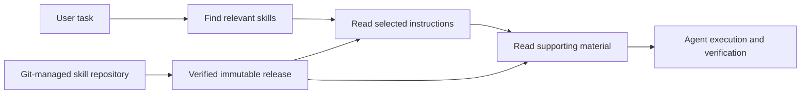

<p align="center"><a href="README.md">English</a> · <a href="README.ko.md">한국어</a></p>

<p align="center">
  
</p>

<h1 align="center">gisul</h1>
<p align="center"><strong>You uploaded tacit knowledge? Cut the bullshit.</strong><br>Stop selling magic. Give your agent a procedure.</p>
<p align="center">
  <a href="#get-started">Get started</a> ·
  <a href="https://github.com/changeroa/gisul-skills">Explore skills</a> ·
  <a href="docs/technical-reference.md">Technical reference</a> ·
  <a href="https://github.com/changeroa/gisul/issues">Report an issue</a>
</p>
<p align="center">
  <a href="LICENSE"></a>
  
  
</p>

---

## You didn't upload expertise. You wrote a prompt.

**A few lines of instructions don't turn a model into a seasoned practitioner.**

“Think like an expert.” “Review this carefully.” “Use your best judgment.”

Fine. What should it read? What should it check? What evidence lets it call the job done?

**gisul is an MCP skill registry that finds and delivers those working instructions.** Agents discover and read Git-managed `SKILL.md` bundles and supporting material when they need them. You don't copy every skill into every agent's directory.

Craftsmanship in a text file? No. **A procedure the agent can at least try to follow? That's the point.**

## Concrete instructions. Verifiable results.

| The vague request | The procedure to load instead |
| --- | --- |
| “Make the UI good.” | Distinguish loading, empty results, missing permissions, and failures. Check the next action in each state. |
| “Review the code carefully.” | Select reviews that match the change's risks. Recheck findings against source code and counterevidence. |
| “The tests pass, right?” | Follow save, failure, recovery, and re-entry—not just a single button click. |

These workflows live in [gisul-skills](https://github.com/changeroa/gisul-skills). **gisul delivers the instructions. gisul-skills maintains their content.** Reading a skill is not proof that the work succeeded.

## Find what matters. Load what you need.



- **Load on demand.** Clients carry a small loader. Workflow content stays remote.
- **Read a consistent version.** Keep instructions and supporting files pinned to the selected release, with file integrity checks.
- **Different agents, shared content.** Supported clients discover the same immutable remote releases.
- **Instructions are not permissions.** Loading a skill does not expand execution authority. Host approval and security policies still apply.

## Get started

**Just browsing? Start with [gisul-skills](https://github.com/changeroa/gisul-skills).**

To connect an agent, follow the installation and authentication guide for your runtime. You need access to the Gisul deployment you connect to. Reading this public repository does not grant access to a hosted server.

| Runtime | Installation and connection |
| --- | --- |
| Codex | [Personal plugin](clients/codex/README.md) · [ARKPOINT team HTTPS plugin](docs/arkpoint-plugin.md) |
| OpenClaw | [Bundle, loader, and OAuth connection](clients/openclaw/README.md) |
| oh-my-openagent / OmO 5 | [Installer and loader](clients/oh-my-openagent/README.md) |
| Gajae Code | [Interview, planning, and execution integration](clients/gajae-code/README.md) |

Once connected, ask:

> Find and read the relevant skills on Gisul, then apply them to this task. Distinguish what you verified from what you haven't checked.

The ARKPOINT team deployment uses separate organization authentication. Personal catalogs are not automatically exposed to the team.

<details>
<summary><strong>Want to run the server yourself?</strong></summary>

With Node.js and npm installed:

```sh
git clone https://github.com/changeroa/gisul.git
cd gisul
npm --prefix server ci
npm --prefix server run build
node server/dist/index.js --http
```

The default HTTP endpoint is `POST http://127.0.0.1:8788/mcp`. Default skill roots are `~/gisul/skills`, `~/.codex/skills`, and `~/.agents/skills`. Starting a local server does not automatically connect it to a hosted catalog.

For production deployment, authentication, and release publication, see the [deployment guide](docs/deployment.md) and [technical reference](docs/technical-reference.md).

</details>

## Windows Docker deployment

The Windows deployment uses this Git repository directly; no source files are
copied over SSH. On the target host, keep the checkout at `E:\git\gisul` and run:

```powershell
powershell -NoProfile -ExecutionPolicy Bypass -File E:\git\gisul\scripts\deploy-windows.ps1 -Force
powershell -NoProfile -ExecutionPolicy Bypass -File E:\git\gisul\scripts\install-windows-autodeploy.ps1
```

The scheduled task checks `origin/main` every minute. A changed commit is checked
out, built with Docker Compose, started with `--wait`, and recorded in
`.docker/deployed-commit`. The existing container stays active while the new image
is building. Runtime state and skills remain outside Git through bind mounts.

## What's in the box

| Path | Responsibility |
| --- | --- |
| [`server/`](server/) | Node.js MCP server exposing local directories over stdio or Streamable HTTP |
| [`worker/`](worker/) | Cloudflare Worker handling authentication and immutable R2 release reads |
| [`clients/`](clients/) | Runtime-specific installers and small skill loaders |
| [`plugins/gisul/`](plugins/gisul/) | Native HTTPS team plugin |
| [gisul-skills](https://github.com/changeroa/gisul-skills) | Independently versioned workflow content |

## Where the claims stop

This started as a personal project. Reading instructions doesn't make an agent an expert. Passing tests doesn't establish production readiness. Check a deployment's actual publication, authentication, discovery, and file-read evidence before treating it as ready.

[Technical reference](docs/technical-reference.md) · [Deployment and rollback](docs/deployment.md) · [Connection diagnostics](docs/connection-diagnostics.md) · [Skill packs](docs/native-packs.md)

## Contributing

Broken connection? [Open an issue](https://github.com/changeroa/gisul/issues) with reproduction steps and sanitized errors. Code changes should include verification evidence. Propose workflow content in [gisul-skills](https://github.com/changeroa/gisul-skills). Keep tokens and personal data out of reports.

[MIT License](LICENSE) · *gisul* comes from the Korean word for skill, craft, or technique.
